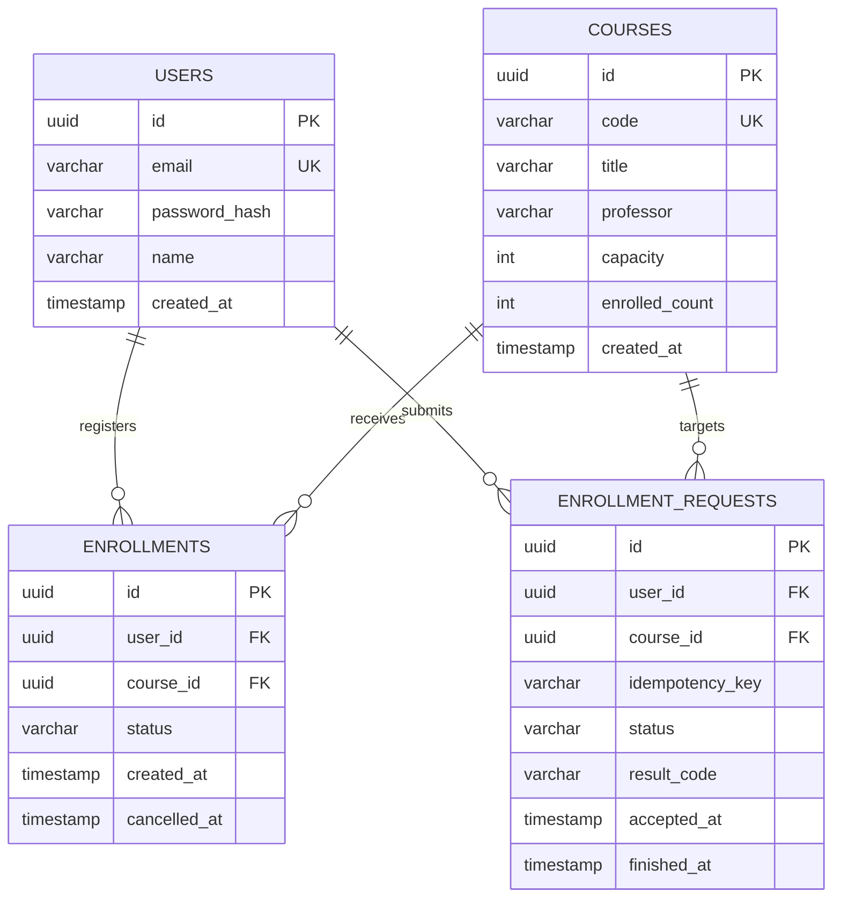

# 데이터 모델 및 정합성 설계 (Draft v0.1)

## 원칙
- **PostgreSQL이 학생·강의·신청 확정 상태의 원본(Source of Truth)**입니다.
- Redis는 대기 상태, 처리 요청·임시 토큰에 사용하지만 수강 확정 여부를 단독 판정하지 않습니다.
- 정원 검증은 애플리케이션의 단순 SELECT 후 INSERT가 아니라 **DB 원자적 변경**으로 수행합니다.

## 개념 ERD


## 테이블과 제약조건
### users
- `id UUID PK`, `email UNIQUE NOT NULL`, `password_hash NOT NULL`, `name NOT NULL`, `created_at`.
- 테스트용 계정만 사용. 평문 비밀번호 저장하지 않음.

### courses
- `id UUID PK`, `code UNIQUE`, `title`, `professor`, `capacity > 0`, `enrolled_count >= 0 AND <= capacity`.
- 정원·카운트는 **신청 확정 트랜잭션 안에서** 갱신.

### enrollments
- `id`, `user_id FK`, `course_id FK`, `status (ACTIVE/CANCELLED)`, `created_at`, `cancelled_at`.
- 활성 신청에 대한 부분 유니크 인덱스: `UNIQUE(user_id, course_id) WHERE status = 'ACTIVE'` (PostgreSQL partial unique index).
- 취소 후 재신청을 허용할 수 있도록 단순 전체 UNIQUE 대신 상태 기준 제약 사용.

### enrollment_requests
- `id`, `user_id`, `course_id`, `idempotency_key`, `status (ACCEPTED/PROCESSING/SUCCEEDED/FULL/DUPLICATE/FAILED)`, `result_code`, 시각.
- `UNIQUE(user_id, idempotency_key)`로 중복 접수 방지.
- **지속형 요청 상태/결과는 PostgreSQL에 저장**해 Redis 메시지 소비 후 장애가 나도 조회·재처리 가능하게 설계. Redis 큐만으로 영속성을 가정하지 않음.

## 신청 확정 트랜잭션 (설계 의사코드)
```sql
BEGIN;
-- 요청 상태 잠금/멱등성 검사, 이미 완료된 요청은 기존 결과 반환
-- 동일 사용자/강의 신청이 이미 활성인지 검증 (최종 보장은 부분 UNIQUE)
UPDATE courses
SET enrolled_count = enrolled_count + 1
WHERE id = :course_id AND enrolled_count < capacity
RETURNING id;
-- 0행이면 FULL. 성공 시 ACTIVE 신청 INSERT
-- 부분 UNIQUE 위반(동시 같은 학생 신청)이면 전체 트랜잭션 ROLLBACK 후 DUPLICATE로 기록
-- 동일 트랜잭션에서 enrollment_requests 상태 갱신
COMMIT;
```
- 유니크 위반/DB 오류 후 결과 기록은 **실패한 트랜잭션 밖의 별도 트랜잭션**에서 처리하거나 savepoint를 사용하는 등 PostgreSQL의 aborted transaction 규칙을 준수.
- 먼저 응모 가능 여부를 SELECT만 하고 판단하지 않음.
- 같은 강의의 경쟁 트랜잭션은 course 행 변경 시 직렬화되므로 핫스팟/락 대기가 발생할 수 있음: 실험 관측 대상.
- **정합성 검증 쿼리:** 각 course별 ACTIVE 수와 enrolled_count 일치, enrolled_count <= capacity, 학생-강의 활성 중복 0.
- Redis Consumer 재전달 시 request 상태 확인으로 동일 신청 2회 실행 방지.

## 취소 트랜잭션
1. 해당 학생의 ACTIVE enrollment을 DB에서 잠금·확인.
2. 상태를 CANCELLED로 바꾸고 course.enrolled_count를 1 감소(동일 트랜잭션).
3. 중복 취소는 멱등적으로 처리하고 음수 카운트를 만들지 않음.

## 동시성과 복구 시 고려사항
- 재시도는 사용자 멱등성 키와 요청 상태를 먼저 조회. 처리 결과를 알 수 없는 일시 장애는 PENDING/UNKNOWN으로 남겨 재조정.
- Redis 재시작으로 대기열 상태가 유실될 경우 자동 신청 성공을 주장하지 않음. PostgreSQL request 레코드 기반 재처리/조정 절차 필요.
- 시드 데이터: 단일 학기, 20~30개 강의(일부 인기 강의는 정원 낮게, 쓰기 부하 실험용 강의는 충분한 정원).
- **구현 전 검증:** 교착상태, 부분 유니크 인덱스, 트랜잭션 롤백, 취소-신청 레이스에 대한 동시성 테스트.
