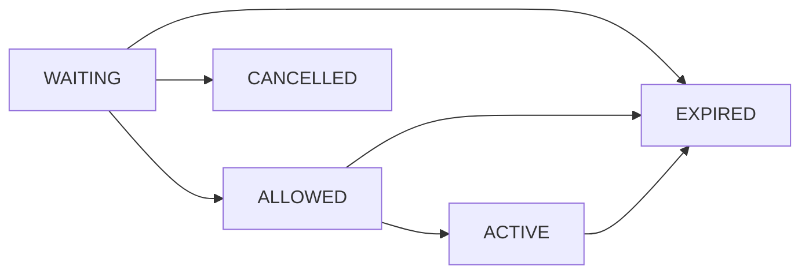
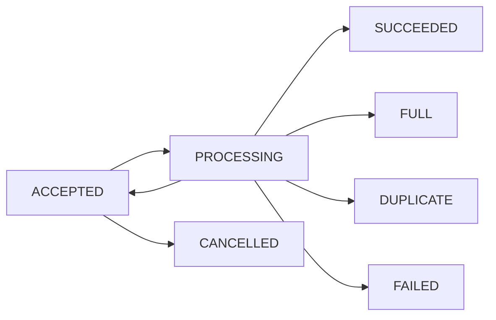

# 2단계 대기열 설계 (Draft v0.1)

## 배경
수강신청이 오전 10시에 시작한다고 가정하면 학생은 **입장 버튼만** 보고 기다립니다. 시작 후 버튼을 누르면 **1차 입장 대기열**이 표시되고, 통과해야 강의 목록을 볼 수 있습니다. 강의 신청 버튼을 누르면 다시 **2차 처리 대기**가 표시되며, 최종 성공/마감/중복 결과를 받습니다.

이는 사용자 경험을 바탕으로 한 **우리가 설계할 아키텍처**입니다. 실제 대학이 내부에서 Redis 큐를 사용하는지는 확인되지 않았습니다.

## 목적의 구분
| 단계 | 보호 대상 | 입출력 |
| --- | --- | --- |
| 1차 입장 대기열 | 로그인 이후 강의 목록/실시간 정원 조회 트래픽 | WAITING → ALLOWED → ACTIVE → EXPIRED/CANCELLED |
| 2차 신청 처리 대기열 | PostgreSQL 쓰기/강의별 행 잠금 경쟁 | ACCEPTED → PROCESSING → SUCCEEDED/FULL/DUPLICATE/FAILED (ACCEPTED → CANCELLED 허용) |

## 1차 — 입장 Gate
1. 서버 시각으로 신청 시작을 검증합니다.
2. 로그인 사용자의 입장 요청을 **원자적으로 한 번만** 등록하고 서버가 순번을 부여합니다. Redis sorted set과 증가 시퀀스, 사용자→ticket 인덱스 등을 검토합니다(원자 등록은 Lua/script 또는 트랜잭션 설계).
3. 클라이언트는 현재 페이지 메모리의 ticket 증명을 사용해 `GET /gate/tickets/me`를 polling하고 heartbeat/lease를 갱신합니다. **새로고침하면 이 증명을 잃으며 기존 대기 순번을 복원하지 않습니다.**
4. Gate admission controller가 계측된 허용 속도·동시 활성 세션 상한에 따라 앞 순번부터 ALLOWED 상태를 발급합니다.
5. 입장권을 수령한 사용자만 강의 조회·신청 API를 호출합니다. 서버는 매 요청마다 입장권 만료/사용자 일치 여부 확인.
6. 입장권은 제한된 유효기간과 활동 갱신 정책을 갖고, 만료 시 재입장을 요구합니다. 초 단위 TTL/동시 입장 상한은 **실험 후 결정**합니다.

**실무적 주의**
- 대기열 등록 API와 polling API 자체가 순간 부하를 받습니다. 원자적 중복 억제, 조회 빈도 제한, 지터·백오프, WAF/ALB 지표로 보호합니다.
- 동시 접속 상한과 초당 입장 허가 속도는 서로 다른 설정입니다. 입장 허가 후 지속되는 정원 조회 트래픽도 고려합니다.
- **새로고침은 의도적으로 1차 대기 취소 및 순번 초기화**로 정의합니다. 브라우저 unload 취소는 보장되지 않으므로 lease 만료와 원자적 이전 ticket 무효화가 필수입니다. 다시 입장할 때는 맨 뒤로 이동하며, 미정리 ticket이 중복 계상되지 않도록 합니다.
- 동일 사용자의 멀티탭이나 재입장으로 동시에 유효한 대기권 2개가 발급되지 않도록 합니다. S4 입장 완료 후의 단순 새로고침은 초기안에서 입장권 유지.
- FIFO는 **Redis에서 확정한 ticket 순서**를 의미하며 네트워크에서 클릭한 실제 시각의 절대적 공정성을 보장하지 않습니다.

## 2차 — 신청 처리 Queue
1. S4에서 학생이 신청을 누르면 서버가 JWT/입장권/수강신청 기간/멱등성 키를 검증합니다.
2. PostgreSQL `enrollment_requests`에 `ACCEPTED` 상태를 내구적으로 기록합니다.
3. Redis Stream 등으로 처리 요청을 전달합니다. 응답은 `202 + requestId`로 주고, 학생은 S5에서 결과를 polling합니다.
4. Worker는 메시지를 받아 DB 트랜잭션에서 **정원 조건부 UPDATE + ACTIVE enrollment INSERT + 요청 상태 갱신**을 처리합니다.
5. Worker 성공 후 메시지를 ACK합니다. ACK 이전 장애로 재전달되더라도 요청 상태/멱등성으로 중복 확정을 방지합니다.
6. 완료된 학생은 SUCCEEDED/FULL/DUPLICATE 등을 확인하고 S4로 돌아옵니다.
7. **S5 새로고침 시** 요청 취소를 시도하되, `ACCEPTED → CANCELLED`가 원자적으로 성공한 경우만 취소 확정. 이미 Worker가 `PROCESSING`으로 선점했다면 처리 결과를 유지하고 사용자에게 확인하도록 안내합니다.

### 중요한 신뢰성 경계
**DB 요청 레코드를 먼저 저장하고 Redis publish에 실패하면 요청이 누락될 수 있습니다.** 구현에서는 아래 둘 중 하나를 선택해야 합니다.
- **권장: transactional outbox** — DB 트랜잭션으로 요청과 outbox 이벤트를 함께 저장하고, 별도 dispatcher가 Redis Stream에 재전송, worker는 중복 안전하게 소비.
- **MVP 대안:** 주기적인 ACCEPTED/PROCESSING 미완료 레코드 재조정·재발행. 메시지 유실 구간과 복구 지연을 실험/문서에 명시.

Redis Streams Consumer Group은 자동 정확히 한 번 처리를 보장하지 않으므로, pending reclaim/재처리/메시지 중복 및 DLQ 유사 격리 정책을 추가 설계합니다.

### 처리 순서와 공정성
- 다중 Worker 및 재시도가 있는 2차 큐에서 완벽한 **전역 FIFO**를 약속하면 안 됩니다.
- 초기 목표는 '수락한 요청에 추적 가능한 순서 부여, 정원 초과/중복 0, 처리 지연 계측'으로 제한합니다.
- **엄격한 강의별 접수 순서로 정원을 배정하려면** 강의별 직렬 처리, 시퀀스/단일 분배자 등 추가 설계를 검토하고 테스트해야 합니다. 단순 Stream XREADGROUP 멀티 Consumer만으로 선착순 공정성을 주장하지 않습니다.

## 상태 머신

## 장애·복구 정책 (초안)
| 실패 | 기대 동작 | 검증 |
| --- | --- | --- |
| 브라우저 새로고침/unload 취소 유실 | 1차 ticket은 lease 만료 또는 새 입장 요청 시 원자 무효화; 새 순번 부여 | 대기권 누수/순번 복원 없음 |
| 2차 새로고침과 Worker 처리 경쟁 | ACCEPTED에서만 취소 성공, PROCESSING 이후 결과 보존 | 취소/처리 이중 확정 없음 |
| 입장 Redis 불가 | 신규 입장/조회/신청을 우회 허용하지 않음 | 503, 오류 로그, 복구 후 상태 점검 |
| 신청 Redis 발행 실패 | DB 요청 기록을 추적해 재발행 | 유실 0 검증 |
| Worker 중지/Task 재시작 | 미처리 pending 재할당, DB request 중복 확인 | 요청 누락·중복 0 |
| RDS 연결 실패 | 신청 확정 중지, 재시도/지수 백오프, 결과 UNKNOWN 유지 가능 | 정원 초과 0 |
| 입장 토큰 재사용/위조 | 사용자/상태/만료 검증 | 403/401 |
| polling 폭주 | 지터·백오프/요청 제한 | polling RPS 및 Redis CPU |
| 오래된 정원 화면 | 신청 확정은 항상 DB 원자 변경 결과 기준 | 초과 신청 0 |

## 대기열 ON/OFF 실험
- **OFF:** 인증 뒤 강의 직접 조회 + 신청은 DB 동기 처리. 서버 인증·제약은 그대로 유지.
- **ON:** 1차 Gate와 2차 비동기 Queue. 대기 상태·HTTP 202는 성공으로 계산하지 않음.
- 동일 트래픽 프로파일, 학생·강의 데이터 및 리소스 한도에서 반복 실험.
- 사용자 여정 기준: 입장 클릭→조회 가능까지, 신청 클릭→결과 확정까지의 p50/p95/p99, 최종 성공 수/오류율, 전체 drain time, queue depth, Task/RDS/Redis 부하와 비용 비교.
- **단계별 효과 식별:** OFF/OFF, ON/OFF, OFF/ON, ON/ON의 2×2 실험이 이상적. 구현·시간이 부족하면 OFF/OFF vs ON/ON을 우선하고 효과의 원인 분리는 제한된다고 명시.
- 공정성 검증: 강의별 request 접수 순서/확정 순서 추적, 정원 경계에서의 결과 일관성 확인.

## 새로고침 정책의 한계
브라우저 새로고침을 서버가 항상 즉시·정확하게 감지할 수는 없습니다. `beforeunload`/`pagehide`나 keepalive 요청은 best effort입니다. 따라서 명세의 '새로고침 시 취소'는 **클라이언트에서 기존 대기권 재사용 금지 + 서버의 취소 요청·lease 만료·재입장 시 무효화**의 조합으로 실현합니다. 네트워크가 끊긴 상태에서 서버 측 회수까지 일정 지연이 생길 수 있습니다. 2차 신청은 DB 트랜잭션 확정 이후에는 UI 새로고침으로 취소할 수 없습니다.

## 확정되지 않은 운영 파라미터
입장 허용 RPS, 활성 입장권 상한, 입장권 TTL/갱신 주기, 2차 Worker 수/배치 크기, 대기열 최대 길이, polling interval, 재처리 timeout, SLO는 **초기 부하 테스트로 정합니다**. 임의로 정한 숫자를 운영에서 검증된 값처럼 사용하지 않습니다.
