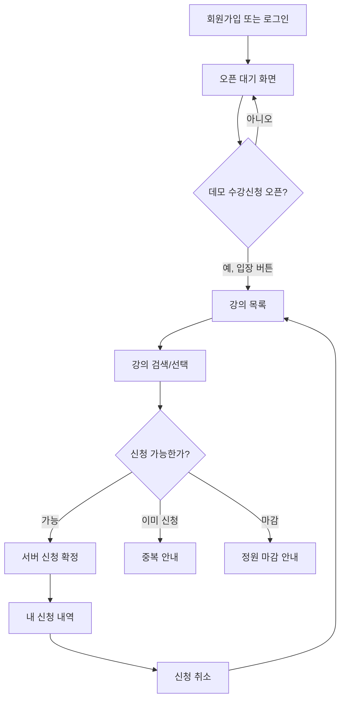

# 사용자 흐름 — Local API MVP (v2)

**현재 구현:** 승인된 대기열 없는 수강신청 UI에 Spring Boot/PostgreSQL API 연동 완료. 서버 인증·기간·정원·중복 검증 적용. 옛 1·2차 큐는 [보류 문서](queue-design.md)에 별도 남겨둠.

## 화면
| ID | 화면 | 구현 동작 |
| --- | --- | --- |
| S1 | 로그인/회원가입 | 로컬 테스트 계정 입력, 유효성 오류, 로그인/로그아웃 |
| S2 | 입장/오픈 대기 | 10:00 시작 안내, 데모 시작 토글/버튼, 오픈 후 입장 |
| S3 | 강의 목록 | 코드·과목명·교수·정원·신청 인원, 검색, 신청 |
| S4 | 내 신청 내역 | 신청한 강의 조회, 취소 |
| S5 | 결과/알림 | 성공/마감/중복/취소 및 입력 오류 |

## 기본 흐름

## 데모 UX 정책
- 실제 10시를 기다리지 않고 **시연용 시작 상태**를 조작할 수 있습니다. 서버 DB의 신청 기간을 검증합니다.
- 입장 클릭 후 **곧바로** 강의 목록으로 이동합니다. 1차 입장 대기/2차 신청 처리 대기/가짜 타이머는 **구현하지 않습니다**.
- 강의 신청·취소는 서버 트랜잭션으로 처리하며, 응답 후 강의 및 본인 내역을 다시 조회합니다.
- 사용자는 마감 강의, 정원에 여유가 있는 강의, 이미 신청한 강의를 구분할 수 있어야 합니다.
- 서버 데이터와 같은 탭의 토큰/입장 플래그로 새로고침을 복원합니다. **데모 초기화**는 명시적인 Compose 볼륨 삭제 절차를 안내합니다. 과거 '대기열 새로고침 시 취소'는 **현재 적용 대상 없음**.
- 실제 수강신청 페이지/강의 목록은 '입장' 후 보여주며 로그인 상태도 지켜야 합니다.

## 승인 및 구현
화면과 흐름은 40e8b79 기준 사용자 승인 완료. 현재 API/DB 계약은 [api.md](api.md), [database.md](database.md), 실제 검증은 [local-validation.md](local-validation.md)에 기록합니다.
