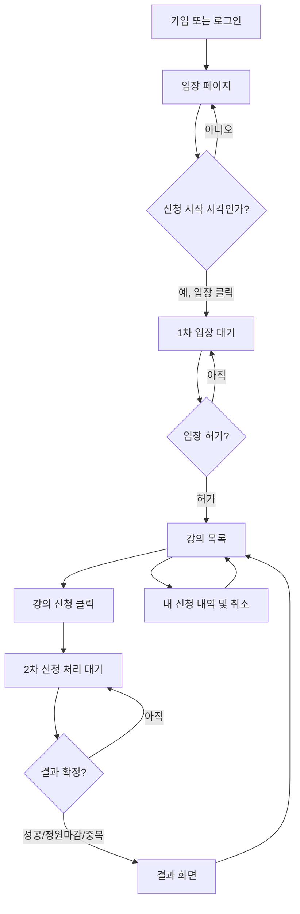

# 사용자 화면 및 흐름 (Draft v0.1)

## 1. 화면 목록
| ID | 화면 | 요소 | 진입 조건 |
| --- | --- | --- | --- |
| S1 | 로그인 / 회원가입 | 이메일·비밀번호·이름(가입), 오류 메시지 | 비로그인 |
| S2 | 입장 페이지 | 10:00 오픈 시각, 서버 기준 시작 카운트다운, 입장 버튼 | 로그인 |
| S3 | 1차 입장 대기 | 대기 순번/상태, 자동 갱신, 재접속 안내 | 입장 요청 등록 |
| S4 | 수강신청 메인 | 강의 검색, 정원·신청 인원, 신청·취소, 내 신청 목록 탭 | 유효한 입장권 |
| S5 | 2차 신청 대기 | 신청 강의, 요청 ID, 접수/대기/처리 상태 | 신청 요청 접수 |
| S6 | 신청 결과 | 성공, 마감, 중복, 실패/재시도 안내 | 결과 확정 |

실제 로그인 전 접근은 인증 페이지로, 입장권 없는 사용자의 S4 접근은 S2/S3로 되돌립니다. **강의 목록은 S2/S3에 노출하지 않습니다.**

## 2. 기본 시나리오

## 3. UI 상태 및 오류 처리
### S2 입장
- 시작 전: 입장 버튼 비활성, 서버 기준 개시 시각 표시.
- 시작 후: 입장 클릭으로 한 번 등록(중복 클릭 시 기존 ticket 반환).
- 만료된 토큰/미인증: 로그인으로 이동.

### S3 1차 대기
- 주기적으로 상태 API polling(초기안 2~3초, 지터/백오프 적용; 실험에서 조절).
- 표시 순번은 추정치일 수 있어 '정확한 입장 시각'을 보장하지 않음.
- 새로고침/브라우저 재접속 시 동일 사용자 대기권 조회. 다른 탭에서 중복 대기권 발급 금지.
- ALLOWED이면 입장권 발급/검증 후 S4 이동; EXPIRED면 재입장 안내.

### S4 강의 목록
- 입장 허가 받은 학생만 강의/정원 API 사용. 브라우저에서 주소 직접 입력해도 서버가 입장권 확인.
- 강의 20~30개, 한 학기. 강의명/교수/정원/신청 인원, 검색/필터.
- 강의 신청 버튼 중복 클릭 차단은 UI 편의 기능일 뿐, 서버 멱등성 필수.
- 신청 취소 후 데이터 재조회; 취소와 신청 경쟁은 DB에서 처리.

### S5 2차 처리 대기
- 요청은 **한 번 접수**하고 상태 API로 결과 확인. 수분 단위 HTTP 연결을 붙잡지 않음.
- 상태 예: ACCEPTED → PROCESSING → SUCCEEDED | FULL | DUPLICATE | FAILED.
- 페이지 새로고침해도 requestId로 복원.
- 장시간 결과가 없는 경우 무조건 재접수하지 않고 같은 requestId로 조회/재시도 안내.

### S6 결과
- 성공: 과목·신청 완료 상태 표시, 목록 돌아가기.
- 정원 마감: 확정 가능한 좌석/정원이 없었음, 목록 돌아가기.
- 중복: 이미 신청된 과목, 현 상태 확인.
- 장애/시간 초과: 결과 미확정과 확정 실패를 구분하고 재조회 안내.

## 4. 대기열 OFF 실험용 화면
- 테스트 환경에서 입장·신청 대기 화면을 건너뛰고 같은 인증·DB 정합성 규칙으로 직접 요청.
- 실험 모드 변경은 서버 설정으로만 수행하고 외부 사용자에게 임의 토글 노출 금지.
- 사용자 관점의 시작~최종 결과 시간 비교에서 S3/S5 대기 시간도 합산.
